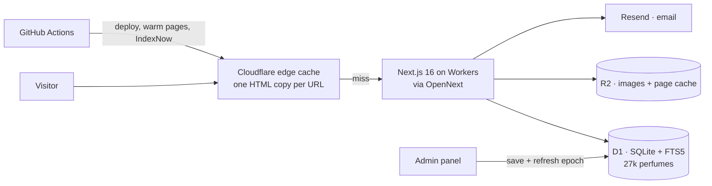
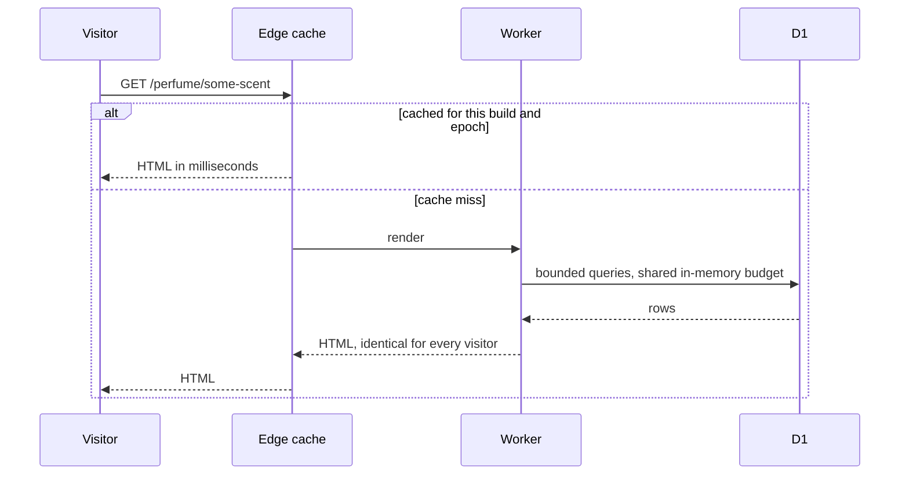

 

<b><a href="#-60-second-tour">Try it</a></b> ·
<b><a href="#-results-that-matter">Results</a></b> ·
<b><a href="#-what-i-built">What I built</a></b> ·
<b><a href="#-architecture">Architecture</a></b> ·
<b><a href="#-problems-i-solved-in-production">Hard problems</a></b> ·
<b><a href="#-tech-stack">Stack</a></b> ·
<b><a href="#-for-recruiters">Hire me</a></b>

---

## 👋 Hi, I'm Vedant

I'm a full-stack engineer with a machine-learning bent. Instead of another to-do-list project, I built **[Scentarchy](https://scentarchy.com)**: a production perfume encyclopedia, dupe finder and price guide for India, with an AI scent finder at its core. It has real data, real pages, real users, a real admin panel and a real deploy pipeline.

> **The fastest way to judge my work is to use it.** Everything below is live and clickable. The code is private because it is a real business, and I am happy to walk through it on a call.

---

## 🚀 60-second tour

Click through the product like a user would. Each link is a real, working page.

| Try this | What you are looking at | Engineering behind it |
|---|---|---|
| **[🔮 AI Scent Finder](https://scentarchy.com/finder)** | Describe a scent in plain words, or answer a short wizard, and get ranked matches with reasons | Intent parsing, weighted note/accord scoring, offline evaluation set |
| **[🧬 Find a Dupe](https://scentarchy.com/find-alternative)** | Pick a designer perfume and see Indian-priced alternatives | Shared-notes/accords similarity, originals ranked before clones |
| **[🌡️ Heat Lab](https://scentarchy.com/climate)** | Which perfumes survive an Indian summer? | Explainable heat model across the whole catalogue, with a confidence level |
| **[🎨 Accord Finder](https://scentarchy.com/accords)** | Mix accords like woody + vanilla + fresh spicy | Accord-vector matching over the catalogue |
| **[🏆 Awards](https://scentarchy.com/awards)** | Animated awards gala with winners and categories | Fully editable from the admin panel |
| **[🏷️ Brand portal](https://scentarchy.com/brands)** | Indian houses submit and manage their own listings | Auth, moderation queue, rights warranty, audit trail |
| **[🔎 Search bar](https://scentarchy.com)** | Type any perfume, house or note | Ranked results, originals before dupes, lazy-loaded UI |
| **[🎁 Giveaways](https://scentarchy.com/giveaways)** | Live giveaways with entries and countdown | Deterministic server rendering, so no hydration drift |

---

## 📊 Results that matter

| | |
|---|---|
| **27,000+ perfumes · 1,145 houses** | Live catalogue (26,898 perfumes verified in the database), grown from about 15,100 in one verified import |
| **11,794 perfumes added in one safe run** | 31-part import with a count check after every part, resumable and idempotent |
| **Finder precision@5: 79.8% → 95.8%** | Free-text queries on a 110-query internal evaluation set (precision@10: 77.3% → 94.5%); guided wizard 82.1% → 97.9% at precision@5 |
| **About 30 KB gzip less JavaScript per page** | Site-wide client-JS cut (about 250 KB less on the quiz page) |
| **8,900+ pages indexed by Google** | Staged sitemap rollout so 11.8k new pages don't flood the crawl |
| **One engineer, end to end** | Product, data, backend, frontend, SEO, infra, admin tooling |

*The finder numbers come from an offline evaluation I wrote for the project. They measure agreement with expected results on that query set, not a public benchmark.*

---

## 🧩 What I built

<b>🤖 AI / ML features</b>

- **AI Scent Finder:** free-text ("fresh summer office scent under ₹1,500", "no oud") and a guided wizard. It parses intent, handles negations and Indian-market phrasing, weights top/heart/base notes and accord strength, and explains every match with the notes that matched. Missing data is handled explicitly so thin records don't outrank well-described perfumes.
- **Dupe engine:** shared notes/accords similarity with live INR price savings, ranked so originals come before clones.
- **India Heat Lab:** an explainable heat model for every perfume, based on note volatility, accord families and concentration. When data is missing it says "estimated from notes" instead of inventing precision.
- **Blind-Buy Risk Score:** a 0–100 risk gauge per perfume.
- **Evaluation first:** I wrote the offline test sets and scripts, then measured before and after, so improvements are numbers and not opinions.

<b>🛒 Product and community</b>

- Price comparison across Indian sellers, with price-led snippets for search
- Accord finder, notes encyclopedia, occasion and weather picks, compare, quiz, wear diary
- Weekly Scent Battles, reviews, forum, giveaways, awards with voting states
- Accounts, notifications, price alerts, newsletter, transactional email
- Brand self-submit portal with a moderation queue

<b>🛠️ Admin tooling</b>

- Full admin panel: houses, perfumes, sellers and prices, dupe mappings, reviews, reports, users, data health, giveaways, notifications
- **Homepage admin:** show, hide, reorder and edit every homepage section; items can be manual, automatic or hybrid. Automatic sections use rules over real data, for example "new launches" only from real launch data, never faked.
- **Awards admin:** editions, categories, nominees and winners, with draft and publish states
- One-click cache refresh so edits show up instantly on an edge-cached site

<b>📈 SEO and growth engineering</b>

- Programmatic pages for perfumes, houses, notes, accords, dupes and "best X under ₹Y" money pages, with JSON-LD schema
- Value-ordered split sitemaps and an **automatic release schedule** that feeds new pages to Google in waves
- IndexNow submission for changed URLs, and a GitHub Action that warms the edge cache after every deploy
- Search Console workflow: query analysis, snippet and CTR fixes, indexing requests

<b>⚖️ Compliance and trust</b>

- A legal risk review covering trademark and dupe wording, copyright and takedown, privacy (DPDP), consumer law, giveaways and contests
- Legal pages, sponsored-link labelling, price disclaimers and a clear data-provenance stance (no fabricated prices, ratings or reviews)

---

## 🏗️ Architecture

**Key decisions:**
- **One cached HTML copy per URL**, so server markup is identical for everyone. No per-visitor or time-dependent output in server HTML.
- **A cache epoch** stored in the database lets the admin invalidate everything after a deploy or import without a redeploy.
- **A shared 100 MB cache budget** keeps the Worker well under its 128 MB limit as the catalogue grew from about 15k to 27k perfumes.

---

## 🔥 Problems I solved in production

<b>Hydration error (React #418) that silently reset dark mode</b>

The homepage flashed light on dark devices. Root cause: a giveaway end time without a timezone was parsed differently on the server and in the browser, so React discarded the server HTML and reset the theme. I fixed the parsing to a single UTC rule, moved the "is it live" decision to the server, and made the theme re-apply after hydration. Fix verified in a fresh browser.

<b>Growing the catalogue 75% without breaking the site</b>

Importing about 11.8k perfumes meant memory limits, slow listing pages and a risk of flooding Google with thin pages. I split the import into 31 verified parts with expected counts, held 2,095 questionable rows and 141 duplicates for review in CSVs, capped Worker memory with a shared cache budget, and staged the new URLs into the sitemaps in waves.

<b>Measured, not guessed, relevance</b>

The scent finder was rebuilt against a 110-query evaluation set I wrote, so every change had a before and after number instead of a feeling.

<b>Fast pages after a 27k-row catalogue</b>

Moved expensive per-render counts behind short-lived caches, cut site-wide client JavaScript, lazy-loaded the search UI and interactive sections, kept hero images eager, and added a post-deploy warm-up so the first real visitor isn't the one who pays for a cold render.

---

## 🛠️ Tech stack

| Layer | What I use |
|---|---|
| **Frontend** | Next.js 16 (App Router), React 19, TypeScript, Tailwind CSS, server components, accessible and reduced-motion-aware animation |
| **Backend and data** | Cloudflare Workers via OpenNext, D1 (SQLite with FTS5 full-text search), R2, custom auth (bcrypt, sessions, tokens), Resend for email |
| **AI / ML** | Custom accord-vector similarity, intent parsing, weighted scoring, offline evaluation harness |
| **Infra and CI/CD** | Cloudflare edge caching, GitHub Actions (deploy warm-up, IndexNow), D1 migrations as reviewed files |
| **SEO** | Programmatic JSON-LD, split sitemaps with release waves, IndexNow, Search Console workflow |
| **Also** | Python, scikit-learn, TensorFlow, pandas, C++, Java, Docker, Express, MongoDB, PostgreSQL |

I also use AI coding agents (Claude Code) in my workflow, with measured evaluations and PR review around them.

---

## 🏅 Beyond the product

- ⚔️ **LeetCode Knight**, max rating **1909**
- 🏆 **Hackathon winner**
- 🚀 **Pre-finalist, Amazon HackOn Season 5**
- 🌱 Learning: advanced ML (deep learning, NLP), system design and cloud architecture

---

## 🤝 For recruiters

| | |
|---|---|
| **What I'm looking for** | Full-stack, ML-adjacent or product-engineering roles where I own features end to end |
| **Strongest proof** | Use [scentarchy.com](https://scentarchy.com) for two minutes, then ask me about anything you clicked |
| **I can walk you through** | Database schema, ranking and evaluation, caching and invalidation, the import pipeline, the admin panel, SEO automation |
| **Source code** | The repository is private, since it is a real business. Code samples and a live walkthrough are available on request |

📫 **[tyagivedant3846@gmail.com](mailto:tyagivedant3846@gmail.com)** · **[vedant@scentarchy.com](mailto:vedant@scentarchy.com)** · **[LinkedIn](https://www.linkedin.com/in/vedant-tyagi-6b380325a/)** · **[Instagram](https://instagram.com/vedant_.tyagi)** · **[LeetCode](https://www.leetcode.com/vedanttyagi04)**

  

