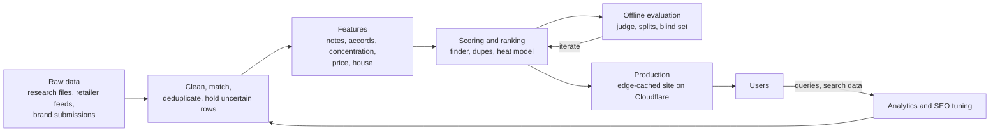

 

<b><a href="#-60-second-tour">Try it</a></b> ·
<b><a href="#-results-that-matter">Results</a></b> ·
<b><a href="#-the-ml-and-data-work">ML and data work</a></b> ·
<b><a href="#-how-the-system-fits-together">System</a></b> ·
<b><a href="#-problems-i-solved">Hard problems</a></b> ·
<b><a href="#-skills">Skills</a></b> ·
<b><a href="#-for-recruiters">Hire me</a></b>

---

## 👋 Hi, I'm Vedant

I work in **machine learning and data science**, and I like models that people actually use. So I built **[Scentarchy](https://scentarchy.com)**: a live perfume encyclopedia, dupe finder and price guide for India. Its core is a ranking and recommendation system over **27,000+ perfumes**, with real data, real users, an evaluation harness and a production deployment.

Most of my time goes into the parts that decide whether ML works: **messy data, feature design, ranking quality, honest evaluation and explaining results**. I also ship the whole thing, from the pipeline to the page, so a model's output reaches a user instead of staying in a notebook.

> **The fastest way to judge my work is to use it.** Everything below is live and clickable. The code is private because it is a real business, and I am happy to walk through it on a call.

---

## 🚀 60-second tour

Each link is a real, working page.

| Try this | What the model or data does | Why it is interesting |
|---|---|---|
| **[🔮 AI Scent Finder](https://scentarchy.com/finder)** | Turns a free-text request or a short wizard into ranked matches with reasons | Weighted note and accord scoring, intent parsing, offline evaluation |
| **[🧬 Find a Dupe](https://scentarchy.com/find-alternative)** | Finds affordable alternatives to a designer perfume | Feature-overlap similarity, with originals ranked before clones |
| **[🌡️ Heat Lab](https://scentarchy.com/climate)** | Scores how a perfume holds up in Indian heat and humidity | Explainable model for the whole catalogue, with a confidence level |
| **[🎨 Accord Finder](https://scentarchy.com/accords)** | Mix accords (woody + vanilla + fresh spicy) and see matches | Accord-vector matching |
| **[🔎 Search](https://scentarchy.com)** | Type any perfume, house or note | Ranked retrieval, originals before dupes, typo tolerance |
| **[🏆 Awards](https://scentarchy.com/awards)** | Animated awards gala | Editable from an admin panel |
| **[🏷️ Brand portal](https://scentarchy.com/brands)** | Indian houses submit their own listings | Data intake with moderation and an audit trail |

---

## 📊 Results that matter

| | |
|---|---|
| **Finder precision@5: 79.8% → 95.8%** | 110 free-text queries on the full 26,898-perfume catalogue (precision@10: 77.3% → 94.5%); wizard on 39 scenarios: 82.1% → 97.9% |
| **Held-out test split: 96.1% precision@5** | 41 queries kept out of weight tuning. On a separate blind set, the first run scored 92.7% before I fixed what it exposed |
| **Hard-constraint violations: 3.0% → 0.1%** | Results that broke the user's stated constraints (price, gender, "no oud") at top 10 |
| **Finder index memory: 66.8 MB → 17.3 MB** | A leaner representation so the model fits the serverless memory budget |
| **Heat model: 0 default scores** | Before, 1,630 perfumes (6.1%) got a placeholder 50. Now missing data shows "no estimate" and every score carries a confidence level (86% complete, 10.5% partial) |
| **50 of 50 sanity checks pass** | Named perfumes by family, pairwise orderings and invariants for the heat model |
| **11,794 perfumes cleaned and added** | 31 verified parts with expected counts, 2,095 uncertain rows held for review, 141 duplicates skipped |
| **Data-quality audit across 26,898 records** | Exact and near-duplicate detection; 20 exact-name groups and 22 looser groups found |

*These are internal measurements. The finder labels are expert-written rules over catalogue data (price, gender, notes, accords, original or dupe), not user clicks, and missing data counts as "not relevant". The blind-set fixes were made after reading its failures, so 92.7% is the honest blind number. I report that gap on purpose.*

---

## 🧠 The ML and data work

<b>🔮 Ranking and recommendation (the AI Scent Finder)</b>

- **Problem framing:** a user describes a scent, a budget and a context. The system must return perfumes that satisfy hard constraints first and then rank by fit.
- **Features:** top, heart and base notes, accord rank and strength, concentration, price, gender, original versus dupe, house.
- **Scoring:** weighted note and accord similarity, with note-family handling and a penalty for thin records so sparse data cannot outrank well-described perfumes.
- **Intent parsing:** handles prices that look like names ("Baccarat Rouge 540" is not a ₹540 budget), reference perfumes ("like X, but cheaper"), negation ("no oud"), brand aliases, typos ("sovage") and Hinglish vocabulary.
- **Explainability:** every result shows the notes and accords that matched.
- **Result:** precision@5 rose from 79.8% to 95.8%, and most of the gain came from parsing and data handling rather than weight tuning, which I measured too.

<b>📏 Evaluation methodology</b>

- A 110-query set plus a wizard set, with an **independent judge** that shares no code with the ranker
- **Dev and held-out test splits**, plus a separate blind set, to check for overfitting
- Per-category breakdowns to find the weak spots: Hinglish and house queries scored about 63 precision@5 before and 100 after
- Hard-constraint violation rate tracked next to precision
- A written note of what the numbers are *not*, so nobody over-reads them

<b>🌡️ Explainable scoring under uncertainty (Heat Lab)</b>

- A deterministic model combining accords, top/heart/base notes and concentration into "holds on skin" and "stays wearable" scores, plus dry-heat, humid-heat, monsoon and air-conditioned variants
- **Uncertainty is part of the output:** each score has a range and a confidence level, and perfumes with no usable data say "no estimate" instead of a made-up number
- Recovers missing concentration from names and descriptions, and down-weights accords that were themselves derived from notes
- Validated with 50 sanity checks and family-level orderings across the whole catalogue

<b>🧹 Data pipeline and quality</b>

- Normalised and merged a 14,030-row research dataset into the live catalogue: cleaned names, matched houses, deduplicated, and **held back 2,095 uncertain rows** instead of guessing
- Idempotent, resumable 31-part import with a verified count after every part
- Explicit handling of missing values (1,295 unknown concentrations, 221 missing genders, flat-only note lists) so gaps don't silently bias rankings
- Near-duplicate detection beyond exact name matches
- Provenance rules: no invented prices, ratings or reviews, and no unlicensed photos

<b>📈 Analytics and search data</b>

- Search Console query analysis: found that traffic came from specific brand and product queries with low click-through, then reshaped snippets and pages around price and intent
- Staged release of 11.8k new pages to search engines in waves, with a data-driven schedule
- Value-ordered sitemaps so the most useful pages are crawled first

---

## 🏗️ How the system fits together

**Serving stack, in short:** Next.js 16 on Cloudflare Workers, D1 (SQLite with full-text search) and R2, with one cached HTML copy per URL, a cache epoch for instant invalidation, and a shared memory budget so models and indexes fit in a 128 MB Worker.

---

## 🔥 Problems I solved

<b>Rankings that looked fine but weren't</b>

Spot-checking looked good, so I wrote an evaluation set and an independent judge. It showed specific failures: a perfume name parsed as a budget, a brand turned into a hard filter, and "no oud" returning oud. Fixing parsing and data handling, not tuning weights, moved the metric from 79.8% to 95.8%.

<b>Never faking certainty</b>

The old heat score gave 6.1% of perfumes a default 50. I replaced it with a model that reports a range and a confidence level, and that says "no estimate" when the data isn't there.

<b>Growing the catalogue by 75% without poisoning it</b>

Importing about 11.8k records meant cleaning, deduplication and a risk of flooding search engines with thin pages. I split the import into 31 verified parts, held back uncertain rows, capped memory, and released the new URLs in waves.

<b>Making models fit a serverless budget</b>

Cut the finder's index from 66.8 MB to 17.3 MB and registered it in a shared memory budget so a 27k-item catalogue runs inside a 128 MB Worker.

<b>Production bugs I debugged end to end</b>

A React hydration error that silently reset dark mode, traced to a timezone-less timestamp parsed differently on server and browser, fixed with a single UTC rule and server-side decisions.

---

## 🧰 Skills

| Area | What I use |
|---|---|
| **ML and data science** | Python, pandas, NumPy, scikit-learn, TensorFlow, similarity and ranking, feature engineering, offline evaluation (precision@k, held-out and blind sets), explainable scoring |
| **Data engineering** | Cleaning and deduplication pipelines, idempotent imports with verification, SQL (SQLite and PostgreSQL), full-text search |
| **Shipping to production** | TypeScript, Next.js 16 (React 19), Cloudflare Workers, D1, R2, GitHub Actions, edge caching, admin tooling |
| **Analytics and growth** | Search Console analysis, structured data, sitemap strategy, IndexNow |
| **Fundamentals** | Data structures and algorithms, competitive programming, C++, Java |

I also use AI coding agents (Claude Code) in my workflow, with measured evaluations and PR review around them.

---

## 🏅 Beyond the product

- ⚔️ **LeetCode Knight**, max rating **1909**
- 🏆 **Hackathon winner**
- 🚀 **Pre-finalist, Amazon HackOn Season 5**
- 🌱 Learning: advanced ML (deep learning, NLP), system design and cloud architecture

---

## 🤝 For recruiters

| | |
|---|---|
| **Roles I'm looking for** | Machine learning engineer, applied data scientist, ML or data-heavy product engineering |
| **Strongest proof** | Use [scentarchy.com](https://scentarchy.com/finder) for two minutes, then ask me about anything you clicked |
| **I can walk you through** | Feature design, ranking and evaluation methodology, the data pipeline and quality checks, uncertainty handling, and how it was deployed |
| **Source code** | The repository is private because it is a real business. Code samples and a live walkthrough are available on request |

📫 **[tyagivedant3846@gmail.com](mailto:tyagivedant3846@gmail.com)** · **[vedant@scentarchy.com](mailto:vedant@scentarchy.com)** · **[LinkedIn](https://www.linkedin.com/in/vedant-tyagi-6b380325a/)** · **[Instagram](https://instagram.com/vedant_.tyagi)** · **[LeetCode](https://www.leetcode.com/vedanttyagi04)**

  

